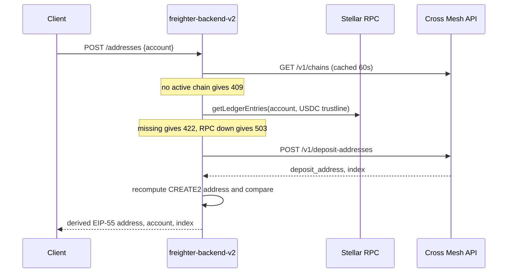

# Cross-Chain Deposit Addresses via Cross Mesh: Design

- **Requirements:** `stellar/wallet-eng-monorepo`,
  `design-docs/cross-chain-deposit-addresses/requirements.md` (PR #115), TR-1 to TR-71
- **Last updated:** 2026-11-13
- **Status:** Proposed. Merge is blocked on the TR-23 ruling (see Known gaps).

## Summary

A Freighter user gets an EVM deposit address from Cross Mesh. USDC sent to that address
on a supported source chain bridges through Circle CCTP to the user's Stellar account.

This design adds four routes under `/api/v1/cross-chain-deposit` to freighter-backend-v2:

```
GET  /api/v1/cross-chain-deposit/chains
POST /api/v1/cross-chain-deposit/addresses
GET  /api/v1/cross-chain-deposit/accounts/{account}/address
GET  /api/v1/cross-chain-deposit/accounts/{account}/deposits
```

The backend holds the Cross Mesh API key. It checks the USDC trustline before it shows an
address. It recomputes every deposit address from the account and the factory and
forwarder-implementation contract addresses hardcoded in our code, and returns only an
address that matches. It builds the transfer list with the user state, the fees, and the
amount still needed to reach the minimum, so both clients share one implementation.

The feature flags endpoint lists the networks where the feature is configured. Today
that is testnet only. Pubnet stays off until Cross Mesh confirms its mainnet contracts.

## Current state

**What Cross Mesh provides.** The Cross Mesh Ingress API issues deposit addresses, lists
source chains with their fees and minimums, and reports deposits and settlements. It has
two environments. Mainnet bridges Ethereum and Polygon to Stellar mainnet. Testnet
bridges Sepolia and Amoy to Stellar testnet with Circle's test USDC. Each environment has
its own API key, contracts, and addresses. There are no webhooks, so status comes from
polling. The API is authenticated with a secret bearer key (`sk_…`).

**What the clients need.** The extension and the mobile app need:

- whether the feature exists on the selected network (TR-2);
- the current source chains, their status, fees, minimums, and delivery estimates
  (TR-9, 11, 12, 34, 43, 45, 46);
- one verified deposit address per account, in EIP-55 form (TR-18 to TR-28);
- the account's transfers, each with a user state, the fees on the right row, and the
  amount still needed when below the minimum (TR-35 to TR-52).

**Why the backend sits in between.** Two reasons.

1. The API key is a secret. The requirements keep it in freighter-backend-v2 and never
   in a client (§1).
2. The status mapping, the fee attribution across settlement rounds, and the
   below-minimum arithmetic are not trivial. Doing them once in the backend gives the
   extension and the mobile app one shared implementation, instead of two that can
   drift.

Nothing in freighter-backend-v2 talks to Cross Mesh today.

## Goals

- Serve the backend side of every backend-facing TR in the requirements, on testnet.
- Keep the Cross Mesh API key server-side only, never in logs, errors, or config dumps.
- Return only deposit addresses that the backend has verified against the requested
  account, on every response.
- Give clients a ready-to-render transfer list with stable error codes.
- Ship pubnet as "not configured" until Cross Mesh confirms mainnet, with no code change
  needed to turn it on beyond the key and the contract addresses.

## Non-goals

- Futurenet. Cross Mesh has no futurenet environment.
- XLM delivery, fast-mode addresses, unfunded accounts, sponsored reserves.
- Self-rescue (sweep), notifications, and dapp access through `@stellar/freighter-api`.
- Any client screen, copy, or telemetry (the client-only TRs listed under Requirements
  compliance).
- A database or a background poller.
- A rate limiter inside the backend.
- Alert rules.

## Design

### Decisions

| # | Decision |
| --- | --- |
| D1 | One implementation for both environments, written against the current v1 testnet spec. An environment is **configured** when its API key is set and its factory and forwarder-implementation contract addresses are hardcoded in our code. Mainnet ships with no key and empty addresses, so pubnet is not configured until Cross Mesh confirms them. An unconfigured network returns 404 `network_not_supported` and is absent from the feature flags. There is no comparison against the API's `contracts` block and no `environment_unavailable` state. |
| D2 | Four routes: `GET …/chains` is public. `POST …/addresses`, `GET …/accounts/{account}/address`, and `GET …/accounts/{account}/deposits` are ordinary gated routes under the global `--auth-mode`, with no per-route override. |
| D3 | The backend composes the deposits view: `user_state`, fee attribution across rounds (TR-39), and `remaining_to_minimum` (TR-49). There is no `partial` flag: any upstream failure while building the view is an error. There is no `hold_detail_code` and no RPC call in the deposits route; the client uses its own balances for TR-48. |
| D4 | The backend recomputes the CREATE2 address on every address response of both routes (TR-25). Inputs are the requested account, the response `index`, `fast=false`, and the hardcoded contract addresses. It returns the locally derived EIP-55 string. The upstream row must have `speed == "standard"` and `delivery_asset == "USDC"`, else 502 `upstream_error`. There is no `verified` field. The doc recommends that clients also verify with the npm verify SDK and their own hardcoded addresses (TR-23 "in its own release"), and asks the requirements owner to make that an explicit client TR. |
| D5 | "Issue" in TR-16 means "show". Both address routes run the USDC trustline check on every response, with one `getLedgerEntries` call for `LedgerKeyAccount` and `LedgerKeyTrustLine(USDC, issuer)`. A missing account returns 422 `account_not_found`. A missing trustline or a limit of 0 returns 422 `usdc_trustline_missing`. An RPC error returns 503 `upstream_unavailable`. `G` accounts only (TR-15). |
| D6 | The feature flag `cross_chain_deposit_networks` lists the networks whose environment is configured per D1. It is derived from config; there is no separate setting and no bool. Config is four flags: `--crossmesh-mainnet-url` and `--crossmesh-testnet-url` (with defaults), `--crossmesh-mainnet-api-key` and `--crossmesh-testnet-api-key` (empty). Constants in code: the USDC issuers, chains TTL 60s, settlement TTL 24h, fan-out concurrency 2, and the contract addresses per environment. Keys are never logged. |
| D7 | Stateless. Redis is a cache only, failing open like the prices service. No Postgres, no poller. |
| D8 | Integration tests use one fake Cross Mesh image with an `ENV` switch and five scenarios: happy path, all chains suspended, lookup with no address, two-round settlement, and one upstream 5xx. |
| D9 | Two caches. Chains for 60s per network, with no stale fallback, so an outage longer than 60s returns 502. Completed settlements (with `delivery` and `fees.cctp_fee` non-null) for 24h per id. Nothing else is cached. |
| D10 | Deposits: `limit=100`, follow `next_cursor` to the end, order by `created_at` descending with `deposit_id` descending as the tiebreak. 10s upstream timeout per call and a 10s handler deadline per route; either returns 504 `upstream_timeout`. |
| D11 | Ten error codes (table below). Unknown upstream codes map by HTTP status. Cross Mesh's `request_id` goes in the error extras. |
| D12 | `{"data": …}` envelope. Amounts stay base-unit strings with `decimals`. |
| D13 | Metrics: the existing service-call metrics for the Cross Mesh client, plus one `verification_failures{network}` counter. No alert rules in this design. |
| D14 | No rate limiter in the backend. Cross Mesh's per-key budget is protected at the edge by a Traefik middleware on the cross-chain path prefix (see Rate limiting). On 422 or 409 from the address routes the client still loads the deposits route, which has no trustline or active-chain gate, so held deposits show as Action needed beside the trustline prompt. |
| D15 | The chains route returns all chains with `status`. The client filters to `active` (TR-11) and shows the TR-14 message on the 409. |
| D16 | Cross Mesh is not part of any health endpoint. |
| D17 | This design doc first, then four stacked PRs. Each PR description quotes the TR text beside the behavior that meets it. |

### Routes and API contract

All four routes take `?network=` with the repo's existing network values (`PUBLIC`,
`TESTNET`, `FUTURENET`, checked by `isValidNetwork`). `PUBLIC` maps to Cross Mesh
mainnet and `TESTNET` to Cross Mesh testnet. An unknown network, `FUTURENET`, or a
network whose environment is not configured returns 404 `network_not_supported`.

The feature flags response gains one field:

```json
{"swap_enabled": true, "discover_enabled": true, "onramp_enabled": true,
 "cross_chain_deposit_networks": ["TESTNET"]}
```

#### `GET /api/v1/cross-chain-deposit/chains`

Public. One upstream call, `GET /v1/chains`, cached 60s per network. Every chain is
returned with its status. `estimated_delivery_seconds` comes from the upstream
`speeds.standard` block and can be null. `fees` can be null. The upstream `contracts`
block is not exposed.

```json
{"data": {"chains": [{
  "chain": "polygon",
  "chain_id": 80002,
  "status": "active",
  "usdc_address": "0x…",
  "confirmations": 3,
  "min_settlement_amount": "2000000",
  "decimals": 6,
  "estimated_delivery_seconds": 180,
  "fees": {"setup_fee": "0", "base_fee": "500000", "fee_rate_ppm": "0", "decimals": 6}
}]}}
```

#### `POST /api/v1/cross-chain-deposit/addresses`

Body `{"account": "G…"}`. Get-or-create. The deposit screen calls it on open (TR-18).

1. Validate the `G` strkey, else 400 `invalid_account`. Check the network is
   configured, else 404.
2. Read chains (cached). No chain `active` returns 409 `no_active_chain`. A fetch
   failure returns 502 `upstream_error`.
3. Trustline check (D5). 422 or 503 on failure.
4. `POST /v1/deposit-addresses` with
   `{"recipient": account, "delivery_asset": "USDC", "speed": "standard"}`.
5. Assert the row is USDC at standard speed. Recompute the address. A mismatch returns
   502 `verification_failed`.
6. Return the derived address:

```json
{"data": {
  "deposit_address": "0x93845A25A3a5F9b15c25532797CE56fD4851Fcce",
  "account": "GBRAD6AQVETCVZDBT3TLU3KXGPQIXOIQX5DLJYKHNZ4ZF6AWYQXEZGQD",
  "index": 0,
  "created_at": "2026-10-20T09:14:02Z"
}}
```



#### `GET /api/v1/cross-chain-deposit/accounts/{account}/address`

Lookup only; it never creates. The Edit account sheet uses it (TR-5, TR-6, TR-10).
Same steps as the POST except step 4, which is
`GET /v1/deposit-addresses?recipient=…&delivery_asset=USDC&speed=standard`. An empty
result returns 404 `no_deposit_address`. The response shape is the same as the POST.

How the Networks row reads the result (TR-5):

- **Two addresses:** 200.
- **One address:** 404 `no_deposit_address`, 404 `network_not_supported`, 409, 422,
  502 `verification_failed`. No deposit address can be shown.
- **Transient:** 503, 504, 502 `upstream_error`. These say nothing about the count. The
  client hides the count or retries.

#### `GET /api/v1/cross-chain-deposit/accounts/{account}/deposits`

Validates the `G` strkey (400 `invalid_account`, TR-15) and the network, then builds the
view described in "Deposits view rules". Upstream calls are `GET /v1/deposits` (all
pages), `GET /v1/settlements/{id}` per round, and `GET /v1/chains` only when a row is
`below_minimum`.

```json
{"data": {"deposits": [{
  "deposit_id": "dep_…",
  "status": "held",
  "hold_reason": "recipient_not_ready",
  "hold_detail": "…",
  "user_state": "action_needed",
  "amount": "1000000",
  "decimals": 6,
  "source_chain": "polygon",
  "source_chain_id": 80002,
  "source_tx": "0x…",
  "destination_tx": null,
  "settlement_id": "stl_…",
  "created_at": "…",
  "updated_at": "…",
  "remaining_to_minimum": null,
  "fees": null
}]}}
```

`remaining_to_minimum` is `{"amount", "decimals"}` or null. `fees` is
`{"setup_fee", "settlement_fee", "cctp_fee", "total_fee", "delivered_amount", "decimals"}`
or null.

### Address verification

Cross Mesh's `DepositFactory.computeAddress` calls OpenZeppelin's
`predictDeterministicAddressWithImmutableArgs`. The npm verify SDK mirrors it offline.
We port it to Go with Keccak-256 from `golang.org/x/crypto/sha3`.

```
recipient = ASCII bytes of the requested G address
args      = recipient ‖ 0x00                      (0x00 = standard, 0x01 = fast)
salt      = keccak256( abi.encode(bytes recipient, uint256 index) )
initCode  = 0x61 ‖ uint16(len(args) + 0x2d)
            ‖ 3d81600a3d39f3363d3d373d3d3d363d73 ‖ implementation
            ‖ 5af43d82803e903d91602b57fd5bf3 ‖ args
address   = keccak256( 0xff ‖ factory ‖ salt ‖ keccak256(initCode) )[12:]
then EIP-55 checksum
```

Inputs, and where each comes from:

- `recipient` is the account the caller asked for, not the `recipient` field in the
  response. An address bound to someone else would verify against that someone else.
- `index` comes from the response. Cross Mesh assigns it per recipient across all
  integrators, so it is not always 0.
- `factory` and `implementation` are the factory and forwarder-implementation contract
  addresses hardcoded in our code, one pair per environment. They never come from the
  API. Testnet: factory `0xAD93f57DeA4F6bE812c0e1790dF5D3d1161BEd09`, implementation
  `0xb0216D95AFf228EB8b3A53C58f780D115eFfEC0F`. Mainnet: empty until Cross Mesh confirms
  them.

The comparison with the upstream address is case-insensitive. The response carries the
derived string, so it is always EIP-55 (TR-28). On a mismatch the route returns 502
`verification_failed`, logs an error, and increments `verification_failures{network}`.
There is no address cache, so every response is checked (TR-25).

Test vectors, testnet contracts, recipient
`GBRAD6AQVETCVZDBT3TLU3KXGPQIXOIQX5DLJYKHNZ4ZF6AWYQXEZGQD`, index 0:

| Speed | Address |
| --- | --- |
| standard | `0x93845A25A3a5F9b15c25532797CE56fD4851Fcce` |
| fast | `0x36b10Bac9dfb4C10947dCd49cB480594F0a1124B` |

Unit tests reproduce both. The fast vector checks the flag byte; the routes only ever
derive standard addresses.

A match proves the address is where the hardcoded factory would deploy a copy of the
hardcoded implementation with this account written into it. It does not prove the
implementation is safe, which is Cross Mesh's audit. It says nothing about deposit,
fee, or status data.

We recommend that the extension and the mobile app also run this check, with
`@lightsail-network/crossmesh-ingress-verify-sdk` (2.0.0-dev.1 or later) and their own
copy of the contract addresses. That puts the check in the client's own release
(TR-23).

### Deposits view rules

**Listing.** Request `limit=100` and follow `next_cursor` to the end. Sort by
`created_at` descending, then `deposit_id` descending (TR-35).

**`user_state` (TR-36, TR-37).**

| Upstream | `user_state` |
| --- | --- |
| `completed` | `completed` |
| `held` with `below_minimum` or `recipient_not_ready` | `action_needed` |
| `held` with `external_settlement_unverified` | `under_review` |
| anything else, including unknown statuses and hold reasons | `pending` |

Completion follows the deposit status only, never `destination_tx` (TR-41).

**Fees (TR-39).** A settlement chain is the set of rounds linked by `continuation_of`.
The backend walks backwards from each deposit's `settlement_id`, keeps a visited set,
and fetches rounds that no deposit references. Fetches run two at a time.

- The owning row is the newest deposit, by `created_at` then `deposit_id`, across all
  rounds of that chain. That is "the newest transfer in that settlement".
- The `fees` object exists once every round's upstream `fees` is non-null.
- `setup_fee` and `settlement_fee` are summed across rounds.
- `cctp_fee` and `total_fee` are null if any round's `cctp_fee` is null, else summed.
- `delivered_amount` is null if any round's `delivery` is null, else summed.
- Every other row has `fees: null`, so a total never shows twice.

**`remaining_to_minimum` (TR-49).** On `below_minimum` rows only:
`chain.min_settlement_amount − sum(amount of all held deposits on that chain)`, whatever
their hold reason. Null if the result is 0 or less. Chains are read only when at least
one `below_minimum` row exists.

**Decimals (TR-47).** `fees.decimals` and `delivery.decimals` must agree across rounds.
A chain's `decimals` must agree with its deposits' `decimals`. A mismatch returns 502
`upstream_error`.

**`settlement_not_found`.** Cross Mesh documents a race where a late deposit moves to
another round. If a settlement fetch returns `settlement_not_found`, the backend
re-lists the deposits once and runs the fan-out again. A second miss returns 502
`upstream_error`.

**Cache as they arrive.** A completed settlement is written to the cache as soon as it
is fetched, not at the end of the request. A retry after a 504 on a long history then
does less work.

**Errors over gaps (TR-52).** Any other settlement or chains fetch failure returns an
error from the table below, never a list with fields missing.

### Error codes

| Code | Status | When |
| --- | --- | --- |
| `invalid_account` | 400 | Not a `G` strkey, or upstream `invalid_stellar_address` |
| `network_not_supported` | 404 | Unknown network, or its environment is not configured |
| `no_deposit_address` | 404 | GET address: none exists (TR-10) |
| `no_active_chain` | 409 | No chain is `active` (TR-14) |
| `account_not_found` | 422 | Account missing on the ledger |
| `usdc_trustline_missing` | 422 | No USDC trustline, or limit 0. Extras `{asset_code, asset_issuer}` |
| `verification_failed` | 502 | CREATE2 mismatch. Also counted and logged as an error |
| `upstream_error` | 502 | Upstream 4xx (including `address_limit_reached` and `authentication_failed`), decode failure, speed or asset mismatch, decimals mismatch, settlement missing after one re-list, chains unavailable |
| `upstream_unavailable` | 503 | Upstream 5xx, or Stellar RPC down for the trustline check |
| `upstream_timeout` | 504 | Upstream timeout or handler deadline |

Unknown upstream codes map by HTTP status. Cross Mesh's `request_id` goes in the extras.
When the global auth mode rejects a request, the account routes return the same 401 as
every other gated route.

### Configuration

Four flags. Viper's `-` to `_` replacer binds each to its env var, for example
`--crossmesh-testnet-api-key` to `CROSSMESH_TESTNET_API_KEY`.

| Flag | Default |
| --- | --- |
| `--crossmesh-mainnet-url` | Cross Mesh mainnet base URL |
| `--crossmesh-testnet-url` | Cross Mesh testnet base URL |
| `--crossmesh-mainnet-api-key` | empty |
| `--crossmesh-testnet-api-key` | empty |

The key is only ever placed in the `Authorization` header. It is not in config dumps,
error messages, or logs.

Constants in code:

- USDC issuers. Mainnet `GA5ZSEJYB37JRC5AVCIA5MOP4RHTM335X2KGX3IHOJAPP5RE34K4KZVN`,
  testnet `GBBD47IF6LWK7P7MDEVSCWR7DPUWV3NY3DTQEVFL4NAT4AQH3ZLLFLA5`.
- Factory and forwarder-implementation contract addresses per environment (mainnet
  empty).
- Chains TTL 60s. Completed settlement TTL 24h.
- Settlement fan-out concurrency 2.
- 10s upstream timeout per call, 10s deadline per route.

### Caching

| Resource | Key | TTL | Why |
| --- | --- | --- | --- |
| Chains | per network | 60s | Every address request reads it, and Cross Mesh says fees and minimums can change. A change shows within a minute. No stale fallback, because TR-12 and TR-45 want current values. |
| Completed settlement | per settlement id | 24h | A settlement with `delivery` and `fees.cctp_fee` recorded never changes. The deposits route reads every round on each poll, so this cuts most upstream load. |

Nothing else is cached. Addresses are not cached because TR-25 wants a fresh check every
time. Deposit lists are not cached so new deposits show on the next poll. In-progress
settlements are not cached because their values change. Redis fails open: a Redis
error means a fetch from Cross Mesh, not a failed request.

Load estimate: 100 users on the transfer screen, polling every 30 seconds with 3
settlements each, is about 13 upstream requests per second uncached and about 3 with the
settlement cache.

### Metrics

The Cross Mesh client records into the existing service-call metrics
(`freighter_service_calls_total`, `freighter_service_call_duration_seconds`,
`freighter_service_errors_total`), the same way the other services do. One new counter,
`verification_failures`, labeled by network, counts derivation mismatches. No alert
rules are part of this design.

### Rate limiting at the edge

The backend has no limiter of its own. The existing Traefik middleware in the kube repo
(`freighter-backend-v2.yaml` in dev, stg, and prd) allows 100 requests per second, burst
500, per client IP on PathPrefix `/`. That protects the pods, not Cross Mesh's per-key
budget: one client could push about 100 address requests per second upstream.

Deployment adds a second Traefik `Middleware`,
`rateLimit: {average: 2, burst: 10, period: 1s}`, per client IP, and an `HTTPRoute` rule
for PathPrefix `/api/v1/cross-chain-deposit` that references it. The host-wide rule
stays as it is.

This is applied to dev only for now. Staging and production get the same change when the
feature is promoted. The numbers move once Cross Mesh states a per-key rate.

## Requirements compliance

One row per backend-facing TR. The TR text is shortened; the requirements doc has the
exact wording.

| TR | Requirement (shortened) | How the backend meets it |
| --- | --- | --- |
| TR-2 | Show the entry point only where Cross Mesh has an environment | `cross_chain_deposit_networks` lists configured networks only |
| TR-5 | Networks row shows the number of addresses | GET address result maps to two, one, or transient (see the GET address route) |
| TR-6 | Sheet lists the Stellar address and the deposit address | GET address returns the verified deposit address |
| TR-8 | Sheet follows the same eligibility, verification, and reuse rules | GET address runs the same trustline check and verification as the POST |
| TR-9 | Sheet shows the listed source chains | Chains route |
| TR-10 | No deposit address yet: list the Stellar address only | GET address returns 404 `no_deposit_address` and never creates |
| TR-11 | List chains with status `active` | Chains route returns every chain with `status`; the client filters |
| TR-12 | Use the current list from Cross Mesh | 60s cache, no stale fallback |
| TR-14 | No active chain: no address, say it is unavailable | 409 `no_active_chain` on both address routes |
| TR-15 | Recipient is the `G` address | 400 `invalid_account` for anything else, on all three account routes |
| TR-16 | No USDC trustline: do not issue an address | Trustline check on every response of both address routes; 422 |
| TR-18 | Get the address automatically on screen open | POST is get-or-create |
| TR-19 | Cannot get an address: error and retry, no address | Every failure returns an error code and no address |
| TR-20 | Show an address only after confirming it commits to the account | Only verified addresses are returned |
| TR-21 | Derive from recipient, index, standard flag, factory, implementation | Derivation above, with the requested account as recipient |
| TR-22 | Use the environment's contract addresses | One hardcoded pair per environment, chosen by `network` |
| TR-23 | Expected addresses in Freighter's own release, not from the API | Hardcoded in the backend release; never read from the API. See the note below |
| TR-24 | Check fails: no address, show an error | 502 `verification_failed` |
| TR-25 | Check every time an address is shown | No address cache; verified on every response of both routes |
| TR-26 | Same address each time | Upstream get-or-create and lookup return the one address per recipient |
| TR-28 | Full address in EIP-55 | The derived EIP-55 string is returned |
| TR-34 | Estimated delivery per chain | `estimated_delivery_seconds` from `speeds.standard`, nullable |
| TR-35 | Each deposit, newest first | All pages, `created_at` desc, `deposit_id` desc |
| TR-36 | Map each deposit to one user state | `user_state` table above |
| TR-37 | Unknown status or reason is Pending | Falls through to `pending` |
| TR-38 | Amount, source chain, user state, recorded time | `amount`, `decimals`, `source_chain`, `user_state`, `created_at` |
| TR-39 | Fees on the newest transfer only, totals across rounds | Fee rules above |
| TR-40 | Open the Stellar transaction when known | `destination_tx`, nullable |
| TR-41 | Completion from the deposit status | `user_state` uses status only |
| TR-43 | Setup fee, base fee, fee rate per chain | `fees` on each chain row |
| TR-45 | Current fees and limits | 60s cache, no stale fallback |
| TR-46 | Minimum settlement amount per chain | `min_settlement_amount` |
| TR-47 | USDC with the decimals Cross Mesh returns | `decimals` beside every amount; a mismatch returns 502 |
| TR-49 | Amount still needed: minimum minus held total on that chain | `remaining_to_minimum` |
| TR-50 | Under review: say so, show support | `user_state: under_review` |
| TR-51 | Support path gives deposit ID, settlement ID, source tx | `deposit_id`, `settlement_id`, `source_tx` on every row |
| TR-52 | Cannot get the list: error and retry | Any fetch failure returns an error, never a partial list |
| TR-57 | Each account has its own address | The recipient is the requested account |

Client-only: TR-1, 3, 4, 7, 13, 17, 27, 29 to 33, 42, 44, 48, 53 to 56, 58 to 71. TR-48
is met client-side from the client's own balances; the backend supplies `hold_reason`
and `hold_detail`.

**TR-23.** Compliance rests on reading "Freighter includes the expected factory and
implementation addresses in its own release" as including the backend. The backend
hardcodes them and never takes them from the API. If the requirements owner reads
"Freighter" as the client only, TR-23 is not met by this design. A written ruling from
the requirements owner blocks merging this doc: either the backend reading is accepted,
or an explicit client-side verification TR is added.

Pubnet is not configured, so no requirement is met on pubnet today.

## Per-environment outcome

| Network | Configured | Behavior |
| --- | --- | --- |
| `TESTNET` | yes: key set, contract addresses hardcoded | All four routes work. Listed in `cross_chain_deposit_networks`. |
| `PUBLIC` | no: no key, empty contract addresses | All four routes return 404 `network_not_supported`. Absent from the feature flags. |
| `FUTURENET` | never | 404 `network_not_supported`. |

Pubnet stays unconfigured until Cross Mesh confirms the mainnet contracts. Facts behind
that:

- **2026-10-19.** Mainnet had no `/v1/settlements` routes. Its chains response used
  `minimum_amount` and `maximum_amount` with per-chain contracts and no `chain_id`. Its
  factory address (`0xa7532c…`) differed from the one Cross Mesh's own verify SDK lists
  for mainnet (`0x8E6Ada…`).
- **2026-10-20.** Every mainnet URL returned a Cloudflare 521: the origin server was
  down.

Turning pubnet on needs Cross Mesh to say which contract set is canonical, to bring
mainnet in line with the v1 spec, and to issue a mainnet key. Then we fill in the
mainnet contract addresses in code and set `CROSSMESH_MAINNET_API_KEY`. No other change.

## Alternatives considered

- **Compare against the API's `contracts` block, with an `environment_unavailable`
  state.** Not needed. The hardcoded addresses already decide the derivation, and an
  empty mainnet pair already keeps pubnet off.
- **Per-route strict auth.** Not needed. The account routes follow the global auth mode
  like every other gated route. Account binding is a follow-up.
- **Partial results on upstream failure.** Not needed. TR-52 asks for an error and a
  retry, and a partial list could hide a fee or a held deposit.
- **A `hold_detail_code` sub-reason for `recipient_not_ready`.** Not needed. The client
  already knows the account's balances and can tell a missing account from a missing
  trustline (TR-48).
- **Extra flags** (an on/off bool, TTLs, issuers, concurrency). Not needed. None of
  these change per deployment; the network list derives from the keys and contract
  addresses.
- **A custom Cross Mesh metric set.** Not needed. The existing service-call metrics
  cover calls, latency, and errors. Only verification failures are new.
- **An in-app rate limiter.** Not needed. The edge middleware protects the per-key
  budget without new code or Redis state.
- **An address cache.** Not needed, and it would break TR-25. The upstream call is
  cheap.
- **Stale chains fallback during an outage.** Not needed. TR-12 and TR-45 want current
  values, so an outage longer than 60s returns 502.

## Known gaps

**For the requirements owner.**

- **TR-23 ruling (blocks merging this doc).** Accept the backend reading, or add an
  explicit client-side verification TR.
- **TR-48.** Please confirm it is met client-side from the client's own balances.
- Three statements in the requirements are out of date with the API:
  - §2 "the API issues standard addresses only": fast mode exists and create requires
    `speed`.
  - §2 `delivered_amount`: settlements now carry `minted_amount` plus a `delivery`
    object.
  - §1 "a request contains only the recipient": it also carries `delivery_asset` and
    `speed`, neither of which is user data.
- The Cross Mesh v1 API is still changing. Between 2026-10-19 and 2026-10-20 the testnet
  spec added required `delivery_asset` and `speed` on create, replaced
  `delivered_amount`, and moved `estimated_delivery_seconds` under `speeds`. Expect at
  least one more adjustment before mainnet.

**For the UI author.**

- Chain names and icons come from the chains route, not from copy. Do not assume a fixed
  Ethereum and Polygon pair (DC-2).
- The transfer list belongs below the QR code on the deposit screen (TR-4, TR-35), not
  behind a separate icon.
- Wrong tokens are not sent back. The forwarder moves USDC only, and TR-33 warns that
  other tokens or chains can lose funds.
- A removed trustline makes an incoming deposit `recipient_not_ready`, which is Action
  needed per TR-36, not Pending. The address routes answer 422 in that state, so load
  the transfer list anyway and show those rows beside the trustline prompt.
- Below-minimum deposits cannot be transferred back to the sender. Self-rescue is out of
  scope; the user tops up on the same chain.
- Pre-provisioning at app open works because the POST is get-or-create. Consequences:
  - It only succeeds for accounts with a USDC trustline (TR-16). Expect a 422 and stay
    silent.
  - Load moves from "deposit screen opens" to "every account on every app open". Cross
    Mesh asks for a few requests per second per key. Pre-provision once per account,
    remember success locally, and still fetch the address when the deposit screen opens
    so it is verified fresh (TR-25).

## Follow-ups

- **Privacy and account binding when auth goes strict.** In permissive mode the JWT
  `sub` is an auth key, not the Stellar account, so any caller can read any account's
  deposit list or trigger address creation. The edge rate limit bounds the volume, not
  the access.
- **Alert thresholds and rate-limit numbers** once Cross Mesh states a per-key rate.
- **Mainnet contract addresses and API key**, which turn pubnet on.
- **Move the testnet key** from the dev deployment env into AWS Secrets Manager
  (`wallet-eng-dev/freighter-backend-v2-dev`, already fed into `envFrom` by the
  ExternalSecret) before staging.
- **Staging and production Traefik rules** for the cross-chain path prefix when the
  feature is promoted.

## Rollout

1. **Dev first.** Apply the dev-only Traefik rule and set `CROSSMESH_TESTNET_API_KEY` on
   the dev deployment. Build the tip of the stacked branches with `build-dev.yml` and
   `deploy_to_dev=true`; Argo's image updater rolls the dev pod. Exercise every flow on
   testnet through the API, including a real Amoy deposit through to `completed`, the
   held flows, and the 429 check on the new edge rule.
2. **Then the PRs.** This doc is PR 0. Then four stacked PRs:
   - PR 1: config, Cross Mesh client, verification, trustline check.
   - PR 2: chains route, address routes, feature flag.
   - PR 3: deposits view.
   - PR 4: fake Cross Mesh image and integration tests (D8).

   Each PR description quotes the TR text beside the behavior. Test names carry the TR
   number, so `go test -run TR16` finds the tests for TR-16.
3. **After merge,** rebuild `main` with `deploy_to_dev=true` so shared dev runs `main`
   again.
