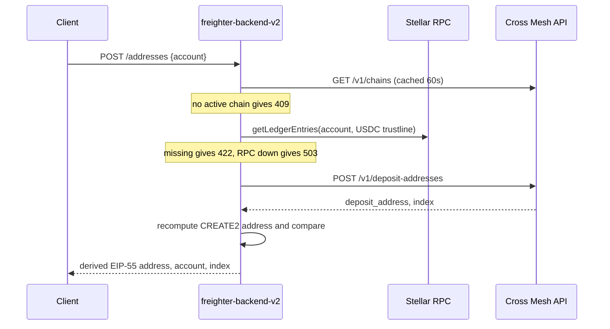

# Cross-Chain Deposit Addresses via Cross Mesh: Design

- **Requirements:** `stellar/wallet-eng-monorepo`,
  `design-docs/cross-chain-deposit-addresses/requirements.md` (PR #115), TR-1 to TR-71
- **Last updated:** 2026-11-16
- **Status:** Implemented on dev. Merge is blocked on the TR-23 ruling (see Known gaps).

## Summary

A Freighter user gets an EVM (Ethereum Virtual Machine) deposit address from Cross Mesh.
The user sends USDC (USD Coin) to the deposit address on a supported source chain. Circle
CCTP (Cross-Chain Transfer Protocol) then bridges the USDC to the Stellar account of the
user.

This design adds four routes under `/api/v1/cross-chain-deposit` to the backend
(freighter-backend-v2):

```
GET  /api/v1/cross-chain-deposit/chains
POST /api/v1/cross-chain-deposit/addresses
GET  /api/v1/cross-chain-deposit/accounts/{account}/address
GET  /api/v1/cross-chain-deposit/accounts/{account}/deposits
```

The backend keeps the key for the Cross Mesh Application Programming Interface (API).
Before the backend shows a deposit address, it does a check of the USDC trustline. The
backend calculates each deposit address again from the account and from the factory and
forwarder-implementation contract addresses hardcoded in our code. The backend returns only
a deposit address that is the same as its calculated deposit address.

The backend makes the transfer list with the user state, the fees, and the amount that is
still necessary to reach the minimum. In this document, "the client" is the Freighter
extension or the Freighter mobile app. Because the backend makes the transfer list, the
extension and the mobile app share one implementation.

The feature flags route lists the networks where the feature is configured. At this time,
the only such network is testnet. Pubnet stays off until Cross Mesh states which mainnet
contracts are correct.

## Current state

**What Cross Mesh supplies.** The Cross Mesh Ingress API issues deposit addresses. It
lists the source chains with their fees and minimums. It also reports deposits and
settlements. The Cross Mesh API has two environments: mainnet and testnet.

Mainnet bridges Ethereum and Polygon to Stellar mainnet. Testnet bridges Sepolia and Amoy
to Stellar testnet with the test USDC from Circle. Each environment has its own API key,
contracts, and deposit addresses. The Cross Mesh API has no webhooks, thus status data
comes only when a caller polls the Cross Mesh API. The Cross Mesh API uses a secret bearer
key (`sk_…`) for authentication.

**What the client needs.** The extension and the mobile app need these items:

- whether the feature exists on the selected network (TR-2);
- the current source chains, with their status, fees, minimums, and delivery estimates
  (TR-9, 11, 12, 34, 43, 45, 46);
- one deposit address for each account, in EIP-55 form, that passed the address
  verification (TR-18 to TR-28);
- the deposits of the account (TR-35 to TR-52). Each deposit has a user state and the
  fees on the correct row. If the deposit is below the minimum, it also has the amount
  that is still necessary.

**Why the backend is between the client and Cross Mesh.** There are two reasons:

1. The API key is a secret. The requirements keep the API key in the backend and never in
   the client (§1).
2. The map from status to user state, the fee attribution across settlement rounds, and
   the below-minimum arithmetic are not simple. When the backend does them one time, the
   extension and the mobile app get one shared implementation. Two separate
   implementations can become different over time.

At this time, the backend does not send requests to Cross Mesh.

## Goals

- Supply the backend part of each TR in the requirements that applies to the backend, on
  testnet.
- Keep the Cross Mesh API key only on the server. Never put the API key in logs, errors,
  or config dumps.
- On each response, return only deposit addresses that passed the address verification
  against the requested account.
- Give the client a list of deposits that is ready to show, with stable error codes.
- Release pubnet in the "not configured" state until Cross Mesh states which mainnet
  contracts are correct. To turn on pubnet, add only the API key and the contract
  addresses. No other code change is necessary.

## Non-goals

- Futurenet. Cross Mesh has no futurenet environment.
- XLM delivery, fast-mode deposit addresses, unfunded accounts, and sponsored reserves.
- Self-rescue (sweep), notifications, and dapp access through `@stellar/freighter-api`.
- Client screens, client text, and client telemetry. The list under Requirements
  compliance gives the client-only TRs.
- A database or a background poller.
- A rate limiter in the backend.
- Alert rules.

## Design

### Decisions

| # | Decision |
| --- | --- |
| D1 | One implementation supports both environments and uses the current v1 testnet spec. An environment is **configured** when it has an API key and the hardcoded contract addresses. Mainnet has no API key, and its hardcoded contract addresses are empty. Thus, pubnet is not configured until Cross Mesh states which mainnet contracts are correct. For a network that is not configured, the routes return 404 `network_not_supported`, and the feature flags do not list that network. The backend does not compare with the `contracts` block of the Cross Mesh API, and there is no `environment_unavailable` state. |
| D2 | There are four routes. `GET …/chains` is public. `POST …/addresses`, `GET …/accounts/{account}/address`, and `GET …/accounts/{account}/deposits` are normal gated routes under the global `--auth-mode`. No route has its own override. |
| D3 | The backend makes the deposits view. The view has `user_state`, the fee attribution across rounds (TR-39), and `remaining_to_minimum` (TR-49). There is no `partial` flag. If an upstream call fails while the backend makes the view, the route returns an error. There is no `hold_detail_code`, and the deposits route makes no Stellar RPC (Remote Procedure Call) call. For TR-48, the client uses its own balances. |
| D4 | On each response of the two address routes, the backend calculates the CREATE2 address again (TR-25). The inputs are the requested account, the `index` from the response, `fast=false`, and the hardcoded contract addresses. The backend returns the EIP-55 string that it calculated. The upstream row must have `speed == "standard"` and `delivery_asset == "USDC"`. If not, the route returns 502 `upstream_error`. There is no `verified` field.<br><br>This document recommends that the client also does the address verification. The client can use the npm verify SDK (software development kit) with its own copy of the contract addresses (TR-23 "in its own release"). This document asks the requirements owner to make that an explicit client TR. |
| D5 | "Issue" in TR-16 means "show". Both address routes do the USDC trustline check on each response. The check is one `getLedgerEntries` call for `LedgerKeyAccount` and `LedgerKeyTrustLine(USDC, issuer)`. If the account does not exist, the route returns 422 `account_not_found`. If there is no USDC trustline, or its limit is 0, the route returns 422 `usdc_trustline_missing`. If the issuer did not authorize the trustline (for example, Circle froze it), the route returns 422 `usdc_trustline_not_authorized`.<br><br>An RPC error gives 503 `upstream_unavailable`. Only `G` accounts are permitted (TR-15). |
| D6 | The feature flag `cross_chain_deposit_networks` lists the networks that have a configured environment (D1). The backend calculates the list from config, and there is no separate config value or bool. The config has four flags: `--crossmesh-mainnet-url` and `--crossmesh-testnet-url` with defaults, and `--crossmesh-mainnet-api-key` and `--crossmesh-testnet-api-key`, which are empty. The constants in code are the USDC issuers, the TTLs, the fan-out concurrency, and the hardcoded contract addresses for each environment. The chains TTL (time to live) is 60s, the settlement TTL is 24h, and the fan-out concurrency is 2. The backend never logs the API keys. |
| D7 | The backend is stateless. Redis is only a cache. If Redis fails, the backend continues without it, as the prices service does. There is no Postgres and no poller. |
| D8 | The integration tests use one fake Cross Mesh image and four scenarios. The scenarios are the happy path, a lookup with no deposit address, a two-round settlement, and one upstream 5xx. The handler test against the real service covers the 409 when all chains are suspended. |
| D9 | There are two caches. The backend caches chains for 60s for each network, with no stale fallback. Thus, if an outage is longer than 60s, the routes return 502. The backend caches each completed settlement for 24h by its id. A completed settlement has non-null `delivery` and `fees.cctp_fee`. The backend caches nothing else. |
| D10 | The deposits route requests `limit=100` and uses `next_cursor` to read all pages. It sorts by `created_at` descending, with `deposit_id` descending as the tiebreak. Each upstream call has a 10s timeout, and each route has an 8s handler deadline. The deadline is 2s less than the 10s server write timeout, so that the error response can get to the client. If one of the two occurs, the route returns 504 `upstream_timeout`. |
| D11 | Twelve error codes are in the table below. The backend maps unknown upstream codes by HTTP (Hypertext Transfer Protocol) status. The error extras contain the Cross Mesh `request_id`. The code `request_canceled` (503) is for a client that disconnects before the answer is ready. The backend does not log `request_canceled` as an error. |
| D12 | Each response uses a `{"data": …}` envelope. Amounts stay as base-unit strings with `decimals`. |
| D13 | For metrics, the Cross Mesh service in the backend uses the current service-call metrics. The design adds one counter, `verification_failures{network}`. This design has no alert rules. |
| D14 | The backend has no rate limiter. A Traefik middleware at the edge protects the per-key budget of Cross Mesh on the cross-chain path prefix (see Rate limit at the edge). If an address route returns 422 or 409, the client still loads the deposits route. The deposits route has no trustline gate and no active-chain gate. Thus, held deposits show as Action needed beside the trustline prompt. |
| D15 | The chains route returns all chains with `status`. The client shows only the `active` chains (TR-11). On the 409, the client shows the TR-14 message. |
| D16 | No health route includes Cross Mesh. |
| D17 | First this design document, then four stacked PRs (pull requests). Each PR description quotes the TR text beside the behavior that satisfies it. |

### Routes and API contract

All four routes take `?network=` with the current network values of the repo: `PUBLIC`,
`TESTNET`, and `FUTURENET`. `isValidNetwork` does a check of these values. `PUBLIC` maps to
Cross Mesh mainnet, and `TESTNET` maps to Cross Mesh testnet. For an unknown network,
`FUTURENET`, or a network that is not configured, the routes return 404
`network_not_supported`.

The feature flags response gets one new field:

```json
{"swap_enabled": true, "discover_enabled": true, "onramp_enabled": true,
 "cross_chain_deposit_networks": ["TESTNET"]}
```

#### `GET /api/v1/cross-chain-deposit/chains`

This route is public. It makes one upstream call, `GET /v1/chains`, and caches the result
for 60s for each network. The route returns each chain with its status.
`estimated_delivery_seconds` comes from the upstream `speeds.standard` block and can be
null. `fees` can also be null. The route does not return the upstream `contracts` block.

```json
{"data": {"chains": [{
  "chain": "polygon",
  "chain_id": 80002,
  "status": "active",
  "usdc_address": "0x…",
  "confirmations": 3,
  "min_settlement_amount": "2000000",
  "decimals": 6,
  "estimated_delivery_seconds": 180,
  "fees": {"setup_fee": "0", "base_fee": "500000", "fee_rate_ppm": "0", "decimals": 6}
}]}}
```

#### `POST /api/v1/cross-chain-deposit/addresses`

The body is `{"account": "G…"}`. The route gets the deposit address, or creates it if it
does not exist (get-or-create). The deposit screen calls this route when it opens (TR-18).

1. The backend does a check of the `G` strkey. If the strkey is not valid, the route
   returns 400 `invalid_account`. If the network is not configured, the route returns 404.
2. The backend reads the chains, from the cache if possible. If no chain is `active`, the
   route returns 409 `no_active_chain`. If the backend cannot get the chains, the route
   returns 502 `upstream_error`.
3. The backend does the trustline check (D5). If the check fails, the route returns 422 or
   503.
4. The backend sends `POST /v1/deposit-addresses` with
   `{"recipient": account, "delivery_asset": "USDC", "speed": "standard"}`.
5. The backend makes sure that the row is USDC at standard speed. Then it calculates the
   deposit address again. If the two deposit addresses are different, the route returns
   502 `verification_failed`.
6. The route returns the calculated deposit address:

```json
{"data": {
  "deposit_address": "0x93845A25A3a5F9b15c25532797CE56fD4851Fcce",
  "account": "GBRAD6AQVETCVZDBT3TLU3KXGPQIXOIQX5DLJYKHNZ4ZF6AWYQXEZGQD",
  "index": 0,
  "created_at": "2026-10-20T09:14:02Z"
}}
```



#### `GET /api/v1/cross-chain-deposit/accounts/{account}/address`

This route only looks up the deposit address. It never creates one. The Edit account sheet
uses this route (TR-5, TR-6, TR-10). The steps are the same as for the POST route, but
step 4 is `GET /v1/deposit-addresses?recipient=…&delivery_asset=USDC&speed=standard`. If
the result is empty, the route returns 404 `no_deposit_address`. The response has the same
shape as the POST response.

How the Networks row uses the result (TR-5):

- **Two addresses:** 200.
- **One address:** 404 `no_deposit_address`, 404 `network_not_supported`, 409, 422,
  502 `verification_failed`. The client cannot show a deposit address.
- **Transient:** 503, 504, 502 `upstream_error`. These codes give no data about the count.
  The client hides the count or tries again.

#### `GET /api/v1/cross-chain-deposit/accounts/{account}/deposits`

The route does a check of the `G` strkey (400 `invalid_account`, TR-15) and of the
network. Then it makes the view that "Deposits view rules" describes. The upstream calls
are `GET /v1/deposits` for all pages and `GET /v1/settlements/{id}` for each round. The
route calls `GET /v1/chains` only when a row is `below_minimum`.

```json
{"data": {"deposits": [{
  "deposit_id": "dep_…",
  "status": "held",
  "hold_reason": "recipient_not_ready",
  "hold_detail": "…",
  "user_state": "action_needed",
  "amount": "1000000",
  "decimals": 6,
  "source_chain": "polygon",
  "source_chain_id": 80002,
  "source_tx": "0x…",
  "destination_tx": null,
  "settlement_id": "stl_…",
  "created_at": "…",
  "updated_at": "…",
  "remaining_to_minimum": null,
  "fees": null
}]}}
```

`remaining_to_minimum` is `{"amount", "decimals"}` or null. `fees` is
`{"setup_fee", "settlement_fee", "cctp_fee", "total_fee", "delivered_amount", "decimals"}`
or null.

### Address verification

The Cross Mesh function `DepositFactory.computeAddress` calls the OpenZeppelin function
`predictDeterministicAddressWithImmutableArgs`. The npm verify SDK does the same
calculation offline. The backend uses a Go port of this calculation, with Keccak-256 from
`golang.org/x/crypto/sha3`.

```
recipient = ASCII bytes of the requested G address
args      = recipient ‖ 0x00                      (0x00 = standard, 0x01 = fast)
salt      = keccak256( abi.encode(bytes recipient, uint256 index) )
initCode  = 0x61 ‖ uint16(len(args) + 0x2d)
            ‖ 3d81600a3d39f3363d3d373d3d3d363d73 ‖ implementation
            ‖ 5af43d82803e903d91602b57fd5bf3 ‖ args
address   = keccak256( 0xff ‖ factory ‖ salt ‖ keccak256(initCode) )[12:]
then EIP-55 checksum
```

The inputs and their sources are:

- `recipient` is the account that the caller requested. It is not the `recipient` field in
  the response. A deposit address for a different account passes the address verification
  only for that different account.
- `index` comes from the response. Cross Mesh assigns it for each recipient across all
  integrators. Thus, it is not always 0.
- `factory` and `implementation` are the hardcoded contract addresses, one pair for each
  environment. They never come from the Cross Mesh API. Testnet: factory
  `0xAD93f57DeA4F6bE812c0e1790dF5D3d1161BEd09`, implementation
  `0xb0216D95AFf228EB8b3A53C58f780D115eFfEC0F`. Mainnet: empty until Cross Mesh states
  which mainnet contracts are correct.

The comparison with the upstream deposit address is case-insensitive. The response
contains the calculated string, thus it is always EIP-55 (TR-28). If the two deposit
addresses are different, the route returns 502 `verification_failed`. The route also logs
an error and adds 1 to `verification_failures{network}`. There is no deposit address cache,
thus the backend does the address verification on each response (TR-25).

Test vectors for the testnet contracts, with recipient
`GBRAD6AQVETCVZDBT3TLU3KXGPQIXOIQX5DLJYKHNZ4ZF6AWYQXEZGQD` and index 0:

| Speed | Address |
| --- | --- |
| standard | `0x93845A25A3a5F9b15c25532797CE56fD4851Fcce` |
| fast | `0x36b10Bac9dfb4C10947dCd49cB480594F0a1124B` |

Unit tests reproduce the two vectors. The fast vector does a test of the flag byte. The
routes calculate only standard deposit addresses.

A match proves one fact. The hardcoded factory would deploy a copy of the hardcoded
implementation at this deposit address, with this account in the copy. A match does not
prove that the implementation is safe. The Cross Mesh audit is for that. A match gives no
data about deposits, fees, or status.

This document recommends that the extension and the mobile app also do the address
verification. They can use `@lightsail-network/crossmesh-ingress-verify-sdk` (2.0.0-dev.1
or later) with their own copy of the contract addresses. Then the check is in the client's
own release (TR-23).

### Deposits view rules

**List order.** The backend requests `limit=100` and uses `next_cursor` to read all pages.
It sorts by `created_at` descending, then by `deposit_id` descending (TR-35).

**`user_state` (TR-36, TR-37).**

| Upstream | `user_state` |
| --- | --- |
| `completed` | `completed` |
| `held` with `below_minimum` or `recipient_not_ready` | `action_needed` |
| `held` with `external_settlement_unverified` | `under_review` |
| any other status or hold reason, also an unknown one | `pending` |

The backend sets completion from the deposit status only, never from `destination_tx`
(TR-41).

**Fees (TR-39).** A settlement sequence is the set of rounds that `continuation_of` links
together. The backend goes back from the `settlement_id` of each deposit and keeps a set of
visited rounds. It also gets the rounds that no deposit references. It gets two rounds at
a time.

- The fee row is the newest deposit across all rounds of that settlement sequence, by
  `created_at` and then by `deposit_id`. That is "the newest transfer in that settlement".
- The `fees` object exists only when the upstream `fees` of each round is non-null.
- `setup_fee` and `settlement_fee` are the sums across rounds.
- `cctp_fee` and `total_fee` are null if the `cctp_fee` of a round is null. If not, they
  are the sums.
- `delivered_amount` is null if the `delivery` of a round is null. If not, it is the sum.
- Each other row has `fees: null`. Thus, a total never shows two times.

**`remaining_to_minimum` (TR-49).** This field is only on `below_minimum` rows:
`chain.min_settlement_amount − sum(amount of all held deposits on that chain)`. The sum
includes all held deposits on that chain, for all hold reasons. If the result is 0 or
less, the value is null. The backend reads the chains only when there is one or more
`below_minimum` row.

**Decimals (TR-47).** `fees.decimals` and `delivery.decimals` must be the same across
rounds. The `decimals` of a chain must be the same as the `decimals` of its deposits. If
they are different, the route returns 502 `upstream_error`.

**`settlement_not_found`.** Cross Mesh documents a race condition: a late deposit can move
to a different round. If a settlement request returns `settlement_not_found`, the backend
gets the deposit list again one time. Then it does the fan-out again. If the settlement is
still not found, the route returns 502 `upstream_error`.

**Cache each settlement immediately.** The backend writes a completed settlement to the
cache immediately after it gets the settlement. It does not wait for the end of the
request. Thus, if the client tries again after a 504 on a long history, the backend does
less work.

**Errors, not gaps (TR-52).** If any other settlement request or chains request fails, the
route returns an error from the table below. The route never returns a list that does not
have all fields.

### Error codes

| Code | Status | When |
| --- | --- | --- |
| `invalid_account` | 400 | Not a `G` strkey, or upstream `invalid_stellar_address` |
| `network_not_supported` | 404 | Unknown network, or a network that is not configured |
| `no_deposit_address` | 404 | GET address route: no deposit address exists (TR-10) |
| `no_active_chain` | 409 | No chain is `active` (TR-14) |
| `account_not_found` | 422 | The account is not on the ledger |
| `usdc_trustline_missing` | 422 | No USDC trustline, or limit 0. Extras `{asset_code, asset_issuer}` |
| `usdc_trustline_not_authorized` | 422 | The issuer did not authorize the USDC trustline. Extras `{asset_code, asset_issuer}` |
| `verification_failed` | 502 | CREATE2 mismatch. The backend also counts it and logs it as an error |
| `upstream_error` | 502 | Upstream 4xx (also `address_limit_reached` and `authentication_failed`), decode failure, speed or asset mismatch, decimals mismatch, settlement not found after one more list request, chains not available |
| `upstream_unavailable` | 503 | Upstream 5xx, or Stellar RPC is down for the trustline check |
| `request_canceled` | 503 | The client disconnects before the answer is ready. The backend does not log it as an error |
| `upstream_timeout` | 504 | Upstream timeout or handler deadline |

The backend maps unknown upstream codes by HTTP status. The error extras contain the Cross
Mesh `request_id`. If the global auth mode rejects a request, the account routes return
the same 401 as all other gated routes.

### Configuration

There are four flags. The Viper `-` to `_` replacer binds each flag to its env var. For
example, it binds `--crossmesh-testnet-api-key` to `CROSSMESH_TESTNET_API_KEY`.

| Flag | Default |
| --- | --- |
| `--crossmesh-mainnet-url` | Cross Mesh mainnet base URL |
| `--crossmesh-testnet-url` | Cross Mesh testnet base URL |
| `--crossmesh-mainnet-api-key` | empty |
| `--crossmesh-testnet-api-key` | empty |

The backend puts the API key only in the `Authorization` header. The API key is not in
config dumps, error messages, or logs.

The constants in code are:

- The USDC issuers. Mainnet `GA5ZSEJYB37JRC5AVCIA5MOP4RHTM335X2KGX3IHOJAPP5RE34K4KZVN`,
  testnet `GBBD47IF6LWK7P7MDEVSCWR7DPUWV3NY3DTQEVFL4NAT4AQH3ZLLFLA5`.
- The hardcoded contract addresses for each environment. The mainnet values are empty.
- Chains TTL 60s. Completed settlement TTL 24h.
- Settlement fan-out concurrency 2.
- A 10s upstream timeout for each call, and an 8s deadline for each route.

### Cache

| Resource | Key | TTL | Why |
| --- | --- | --- | --- |
| Chains | per network | 60s | Each address request reads the chains, and Cross Mesh says that fees and minimums can change. A change shows in 1 minute or less. There is no stale fallback, because TR-12 and TR-45 ask for current values. When the cache has no entry, concurrent requests for one network share one upstream call. |
| Completed settlement | per settlement id | 24h | A settlement with recorded `delivery` and `fees.cctp_fee` never changes. The deposits route reads each round on each poll, thus this cache removes most upstream load. |

The backend caches nothing else. It does not cache deposit addresses, because TR-25 asks
for a new check each time. It does not cache deposit lists, so that new deposits show on
the subsequent poll. It does not cache settlements that are in progress, because their
values change. If Redis fails, the backend gets the data from Cross Mesh, and the request
does not fail.

Load estimate: 100 users on the deposit screen poll every 30 seconds, with 3 settlements
each. Without the cache, this is approximately 13 upstream requests per second. With the
settlement cache, it is approximately 3.

### Metrics

The Cross Mesh service records into the current service-call metrics
(`freighter_service_calls_total`, `freighter_service_call_duration_seconds`,
`freighter_service_errors_total`), as the other services do. One new counter,
`verification_failures`, has a network label. It counts the mismatches in the address
verification. This design has no alert rules.

### Rate limit at the edge

The backend has no rate limiter of its own. The current Traefik middleware is in the kube
repo, in `freighter-backend-v2.yaml` for dev, stg, and prd. It permits 100 requests per
second, burst 500, for each client IP on PathPrefix `/`. That middleware protects the pods,
but it does not protect the per-key budget of Cross Mesh. One client could send
approximately 100 address requests per second to Cross Mesh.

The deployment adds a second Traefik `Middleware`,
`rateLimit: {average: 2, burst: 10, period: 1s}`, for each client IP. The deployment also
adds an `HTTPRoute` rule for PathPrefix `/api/v1/cross-chain-deposit` that references it.
The host-wide rule does not change.

At this time, this change is only on dev. Staging and production get the same change when
we promote the feature. The numbers will change when Cross Mesh states a per-key rate.

## Requirements compliance

There is one row for each TR that applies to the backend. The table gives a short form of
each TR. The requirements document has the exact text.

| TR | Requirement (shortened) | How the backend satisfies it |
| --- | --- | --- |
| TR-2 | Show the entry point only where Cross Mesh has an environment | `cross_chain_deposit_networks` lists only configured networks |
| TR-5 | Networks row shows the number of addresses | The GET address result maps to two, one, or transient (see the GET address route) |
| TR-6 | Sheet lists the Stellar address and the deposit address | GET address returns the deposit address after the address verification |
| TR-8 | Sheet uses the same eligibility, verification, and reuse rules | GET address does the same trustline check and address verification as the POST |
| TR-9 | Sheet shows the listed source chains | Chains route |
| TR-10 | No deposit address yet: list the Stellar address only | GET address returns 404 `no_deposit_address` and never creates a deposit address |
| TR-11 | List chains with status `active` | The chains route returns each chain with `status`. The client filters the chains |
| TR-12 | Use the current list from Cross Mesh | 60s cache, no stale fallback |
| TR-14 | No active chain: no deposit address, say it is unavailable | 409 `no_active_chain` on both address routes |
| TR-15 | Recipient is the `G` address | 400 `invalid_account` for all other values, on all three account routes |
| TR-16 | No USDC trustline: do not issue a deposit address | Trustline check on each response of both address routes; 422 |
| TR-18 | Get the deposit address automatically when the screen opens | POST is get-or-create |
| TR-19 | Cannot get a deposit address: error and retry, no deposit address | Each failure returns an error code and no deposit address |
| TR-20 | Show a deposit address only after a check that it commits to the account | The backend returns only deposit addresses that passed the address verification |
| TR-21 | Calculate from recipient, index, standard flag, factory, implementation | The calculation above, with the requested account as recipient |
| TR-22 | Use the contract addresses of the environment | One hardcoded pair for each environment, selected by `network` |
| TR-23 | Expected addresses in Freighter's own release, not from the API | Hardcoded in the backend release; never read from the Cross Mesh API. See the note below |
| TR-24 | Check fails: no deposit address, show an error | 502 `verification_failed` |
| TR-25 | Do the check each time a deposit address shows | No deposit address cache; address verification on each response of both routes |
| TR-26 | Same deposit address each time | Upstream get-or-create and lookup return the one deposit address for each recipient |
| TR-28 | Full deposit address in EIP-55 | The route returns the calculated EIP-55 string |
| TR-34 | Estimated delivery for each chain | `estimated_delivery_seconds` from `speeds.standard`, nullable |
| TR-35 | Each deposit, newest first | All pages, `created_at` desc, `deposit_id` desc |
| TR-36 | Map each deposit to one user state | `user_state` table above |
| TR-37 | Unknown status or reason is Pending | Goes to `pending` |
| TR-38 | Amount, source chain, user state, recorded time | `amount`, `decimals`, `source_chain`, `user_state`, `created_at` |
| TR-39 | Fees on the newest transfer only, totals across rounds | Fee rules above |
| TR-40 | Open the Stellar transaction when known | `destination_tx`, nullable |
| TR-41 | Completion from the deposit status | `user_state` uses only the status |
| TR-43 | Setup fee, base fee, fee rate for each chain | `fees` on each chain row |
| TR-45 | Current fees and limits | 60s cache, no stale fallback |
| TR-46 | Minimum settlement amount for each chain | `min_settlement_amount` |
| TR-47 | USDC with the decimals that Cross Mesh returns | `decimals` beside each amount; a mismatch returns 502 |
| TR-49 | Amount still necessary: minimum minus held total on that chain | `remaining_to_minimum` |
| TR-50 | Under review: say so, show support | `user_state: under_review` |
| TR-51 | Support path gives deposit ID, settlement ID, source tx | `deposit_id`, `settlement_id`, `source_tx` on each row |
| TR-52 | Cannot get the list: error and retry | Any request failure returns an error, never a partial list |
| TR-57 | Each account has its own deposit address | The recipient is the requested account |

Client-only: TR-1, 3, 4, 7, 13, 17, 27, 29 to 33, 42, 44, 48, 53 to 56, 58 to 71. The
client satisfies TR-48 from its own balances. The backend supplies `hold_reason` and
`hold_detail`.

**TR-23.** TR-23 says: "Freighter includes the expected factory and implementation
addresses in its own release". Compliance depends on one condition: "Freighter" in that
text includes the backend. The backend has the hardcoded contract addresses and never gets
them from the Cross Mesh API. If the requirements owner decides that "Freighter" means only
the client, this design does not satisfy TR-23. This document cannot merge until the
requirements owner gives a written ruling. The ruling must accept the backend meaning, or
add an explicit TR for address verification in the client.

Pubnet is not configured. Thus, at this time, this design satisfies no requirement on
pubnet.

## Per-environment outcome

| Network | Configured | Behavior |
| --- | --- | --- |
| `TESTNET` | yes: key set, contract addresses hardcoded | All four routes work. `cross_chain_deposit_networks` lists it. |
| `PUBLIC` | no: no key, empty contract addresses | All four routes return 404 `network_not_supported`. The feature flags do not list it. |
| `FUTURENET` | never | 404 `network_not_supported`. |

Pubnet stays not configured until Cross Mesh states which mainnet contracts are correct.
These facts are the reasons:

- **2026-10-19.** Mainnet had no `/v1/settlements` routes. Its chains response used
  `minimum_amount` and `maximum_amount`, with contracts for each chain and no `chain_id`.
  Its factory address (`0xa7532c…`) was different from the mainnet factory address in the
  Cross Mesh verify SDK (`0x8E6Ada…`).
- **2026-10-20.** Each mainnet URL returned a Cloudflare 521. The origin server was down.

To turn on pubnet, Cross Mesh must do three things. It must say which contract set is
canonical. It must make mainnet agree with the v1 spec. It must issue a mainnet API key.
Then we add the mainnet contract addresses in code and set `CROSSMESH_MAINNET_API_KEY`. No
other change is necessary.

## Alternatives considered

- **Compare with the `contracts` block of the Cross Mesh API, with an
  `environment_unavailable` state.** Not necessary. The hardcoded contract addresses
  already control the calculation. The empty mainnet pair already keeps pubnet off.
- **Strict auth for each route.** Not necessary. The account routes obey the global auth
  mode, as all other gated routes do. Account binding is a follow-up.
- **Partial results on upstream failure.** Not necessary. TR-52 asks for an error and a
  retry. A partial list could hide a fee or a held deposit.
- **A `hold_detail_code` sub-reason for `recipient_not_ready`.** Not necessary. The client
  already knows the balances of the account. The client can see if the account or the
  trustline does not exist (TR-48).
- **More flags** (a bool to turn the feature on and off, TTLs, issuers, concurrency). Not
  necessary. These values do not change for each deployment. The network list comes from
  the API keys and the hardcoded contract addresses.
- **A custom Cross Mesh metric set.** Not necessary. The current service-call metrics
  count calls, latency, and errors. Only verification failures are new.
- **A rate limiter in the backend.** Not necessary. The edge middleware protects the
  per-key budget without new code or Redis state.
- **A deposit address cache.** Not necessary, and it would break TR-25. The upstream call
  costs little.
- **A stale chains fallback during an outage.** Not necessary. TR-12 and TR-45 ask for
  current values. Thus, if an outage is longer than 60s, the routes return 502.

## Known gaps

**For the requirements owner.**

- **TR-23 ruling (it blocks the merge of this document).** Accept the backend meaning, or
  add an explicit TR for address verification in the client.
- **TR-48.** Please agree that the client satisfies TR-48 from its own balances.
- Three statements in the requirements do not agree with the current Cross Mesh API:
  - §2 "the API issues standard addresses only": fast mode exists, and the create request
    must have `speed`.
  - §2 `delivered_amount`: at this time, settlements have `minted_amount` and a `delivery`
    object.
  - §1 "a request contains only the recipient": a request also has `delivery_asset` and
    `speed`. These fields are not user data.
- The Cross Mesh v1 API continues to change. Between 2026-10-19 and 2026-10-20, the
  testnet spec made three changes. It added `delivery_asset` and `speed` as necessary
  fields on create. It replaced `delivered_amount`. It moved `estimated_delivery_seconds`
  under `speeds`. Expect one or more changes before mainnet.

**For the UI (user interface) author.**

- Chain names and icons come from the chains route, not from the app text. Do not think
  that the chains are always the pair Ethereum and Polygon (DC-2).
- The transfer list goes below the QR code on the deposit screen (TR-4, TR-35). It does
  not go behind a separate icon.
- Cross Mesh does not send wrong tokens back. The forwarder moves only USDC. TR-33 warns
  that other tokens or chains can cause a loss of funds.
- If the user removes the trustline, a deposit that arrives after that is
  `recipient_not_ready`. Per TR-36, this state is Action needed, not Pending. In this
  state, the address routes return 422. Thus, load the transfer list and show those rows
  beside the trustline prompt.
- `usdc_trustline_not_authorized` means that the issuer froze the trustline. A new
  trustline does not correct this. Do not show the trustline prompt for this code.
- Below-minimum deposits cannot go back to the sender. Self-rescue is out of scope. The
  user adds more USDC on the same chain.
- The client can get the deposit address when the app opens (pre-provision), because the
  POST is get-or-create. The results are:
  - Pre-provision works only for accounts with a USDC trustline (TR-16). Expect a 422,
    and do not show it to the user.
  - The load changes from "the deposit screen opens" to "each account on each app open".
    Cross Mesh asks for a few requests per second for each key. Pre-provision one time for
    each account, and keep a local record of the success. Still get the deposit address
    when the deposit screen opens, so that the address verification is new (TR-25).

## Follow-ups

- **Privacy and account binding when auth becomes strict.** In permissive mode, the JWT
  (JSON Web Token) `sub` is an auth key, not the Stellar account. Thus, any caller can read
  the deposit list of any account, or cause the creation of a deposit address. The edge
  rate limit controls the volume, not the access.
- **Alert thresholds and rate-limit numbers**, when Cross Mesh states a per-key rate.
- **Mainnet contract addresses and API key**, which turn on pubnet.
- **Move the testnet API key** from the dev deployment env into AWS (Amazon Web Services)
  Secrets Manager (`wallet-eng-dev/freighter-backend-v2-dev`) before staging. The
  ExternalSecret already supplies that secret to `envFrom`.
- **Staging and production Traefik rules** for the cross-chain path prefix, when we
  promote the feature.
- **Full trustline limit.** The address routes do not find a trustline that has no space
  left, because the deposit amount is not known at that time. Cross Mesh holds such a
  deposit as `recipient_not_ready`, and the deposits route shows it.

## Rollout

1. **Dev first.**
   1. Apply the dev-only Traefik rule.
   2. Set `CROSSMESH_TESTNET_API_KEY` on the dev deployment.
   3. Build the tip of the stacked branches with `build-dev.yml` and `deploy_to_dev=true`.
      The Argo image updater then rolls out the dev pod.
   4. Do a test of each flow on testnet through the API. Include these flows:
      - a real Amoy deposit until its status is `completed`;
      - the held flows;
      - the 429 check on the new edge rule.
2. **Then the PRs.** This document is PR 0. Open four stacked PRs:
   - PR 1: config, Cross Mesh service, address verification, trustline check.
   - PR 2: chains route, address routes, feature flag.
   - PR 3: deposits view.
   - PR 4: fake Cross Mesh image and integration tests (D8).

   In each PR description, quote the TR text beside the behavior. Put the TR number in
   each test name. Then `go test -run TR16` finds the tests for TR-16.
3. **After the merge,** rebuild `main` with `deploy_to_dev=true`. Then the shared dev
   deployment runs `main` again.
